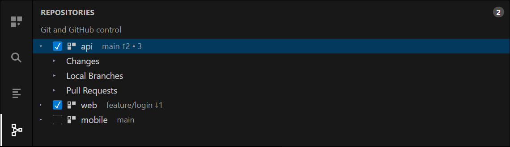
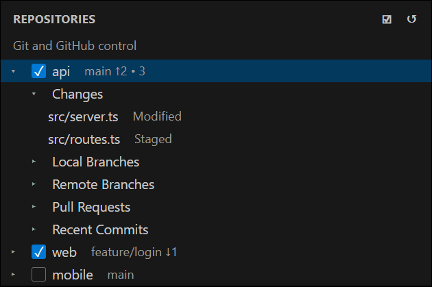
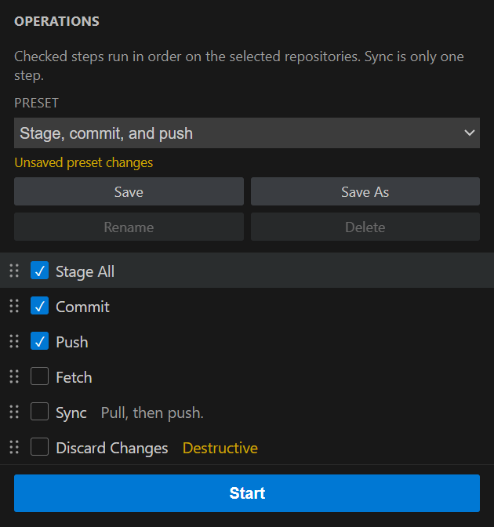
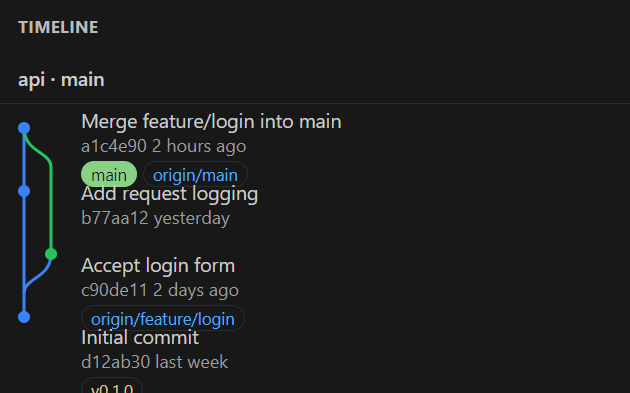

<p align="center">
  
</p>

# Multi Repo Sync

Multi Repo Sync is a VS Code and Cursor sidebar for Git and GitHub actions across many repositories. Sync is only one step. You choose repositories, choose and order the steps, then start the run yourself. The interface language is English.



## Views

The extension adds its own activity-bar container, next to Explorer and Source Control. It has three views.

### Repositories

Every Git repository opened by VS Code is listed here, including multi-root workspaces and nested repositories that VS Code scans. Each repository has a checkbox. The row shows the current branch, how many commits it is ahead or behind its upstream, and how many files are dirty.

Expand a repository to see changes, local branches, remote branches, open pull requests, and recent commits. The view badge counts the selected repositories. The subtitle says this is Git and GitHub control, not a sync-only tool.



### Operations

Steps come from a fixed catalog. Checked steps run from top to bottom on the selected repositories. Unchecked steps stay in the list and are skipped.

Presets work like Photoshop presets. A combo box lists the built-in presets and the ones you save. Choosing a preset loads its checked steps and their order. It does not start the run. If you then change a checkbox or drag the list, the preset is marked unsaved. **Save** writes those changes back when the preset is yours, or asks for a new name when it is built in. **Save As** always creates a new preset. **Rename** and **Delete** apply to your presets. Built-in presets stay in the list.

Drag a row by the handle on its left. **Start** is the full-width button under the list. While a run is in progress that button becomes **Stop**.



Built-in presets:

| Preset | Checked order |
| --- | --- |
| Fetch | Fetch |
| Pull | Pull |
| Sync | Fetch, Pull, Push |
| Stage, commit, and push | Stage All, Commit, Push |
| Commit and push | Commit, Push |
| Publish Branch | Publish Branch |
| Pull request | Push, Create Pull Request |

### Timeline

The history of the repository selected in the Repositories tree is drawn as one continuous lane graph. Branch and tag names sit beside the commit. Click a commit or a branch pill to check it out, copy it, or open it on GitHub. The colored lines run through each row without a break between commits.



## Install

VS Code 1.85 or newer, or a current Cursor release. Both load the same package. The extension uses only the stable VS Code API.

From source:

```bash
git clone https://github.com/ondery/multi-repo-sync.git
cd multi-repo-sync
npm install
npm test
npm run compile
npx @vscode/vsce package
```

Install the `.vsix` from the Extensions view with **Install from VSIX...**, then reload the window. Multi Repo Sync appears on the activity bar. To debug, open this folder and launch **Run Extension**.

## Use

1. In **Repositories**, check the repositories you want to include. The title actions can select all of them or clear the selection.
2. In **Operations**, pick a preset from the combo box, or check steps yourself. Picking a preset only loads the checks and the order.
3. Drag the left handles until the order is right. Commit belongs before push. A pull request belongs after the branch has been published.
4. If you changed a saved preset, use **Save** or **Save As**. Nothing runs until you press **Start**.
5. Press **Start**. Only one run is active at a time. Stop it from the button or the progress notification.
6. The log is in the **Output** panel, channel **Multi Repo Sync**.

The default order is per repository: `api` finishes Fetch, Pull, and Push, then `web` does the same steps. Set `multiRepoSync.runOrder` to `perOperation` to run one step on every selected repository before the next step.

## Step catalog

| Step | What it does |
| --- | --- |
| Fetch | Downloads remote refs. |
| Pull | Updates the current branch using the repository's own pull setting. |
| Stage All | Stages working tree and untracked files. |
| Commit | Opens VS Code's own commit input and waits until the message is confirmed. |
| Push | Pushes the current branch to its upstream. |
| Sync | Pulls, then pushes. This is one step, not the whole extension. |
| Publish Branch | Pushes the branch and sets its upstream. |
| Stash | Stashes changes, including untracked files. |
| Pop Stash | Restores the latest stash. |
| Checkout Branch | Checks out one branch name, asked once per run. |
| Create Branch | Creates and checks out one branch name, asked once per run. |
| Merge | Merges the chosen branch into the current one. A conflict fails the step. |
| Rebase | Rebases onto the chosen branch. A conflict fails the step. |
| Create Tag | Creates a tag with the name asked once per run. |
| Create Pull Request | Pushes the branch and opens a pull request on github.com. |
| Discard Changes | Discards uncommitted changes after confirmation. Unchecked by default. |
| Force Push (With Lease) | Pushes with `--force-with-lease` after confirmation. Unchecked by default. |

Branch name, merge target, rebase target, tag name, and pull-request base are asked once per run and reused for every selected repository. The commit message is separate for each repository.

A step is skipped, with a reason in the log, when a repository has nothing to do or does not have the requested branch. Destructive steps ask for confirmation in each repository.

## The commit step waits

Commit is an ordinary step. The runner calls the built-in `git.commit` command for that repository. The second argument is `null`, so Source Control does not run its own post-commit push or sync. The next step stays the one in your list.

The command does not finish until the message is confirmed:

- When `git.useEditorAsCommitInput` is on, the VS Code and Cursor default, the `COMMIT_EDITMSG` editor opens.
- When it is off, the built-in quick input opens.
- If that repository's Source Control box already contains a message, the built-in command uses it and the log says so.

If the command returns and HEAD did not change, and the repository had changes, the step was cancelled. You can **Stop**, **Skip Repository**, or **Retry**. If there is nothing to commit, the built-in Git dialog speaks and this extension does not open a second one.

## Context menus

The menu follows the kind of row in the repository tree.

- **Repository:** fetch, pull, push, sync, stage all, commit, open on GitHub, open compare, reveal in Explorer, open a terminal, copy the path.
- **Branch:** checkout, merge into the current branch, publish, delete, copy the name, open on GitHub.
- **Change:** open, stage, unstage, discard.
- **Commit:** copy the hash, copy the message, check out the commit, open on GitHub.
- **Pull request:** open in the browser, check out its branch.

GitHub actions appear only when a remote points at github.com.

## GitHub

Remote URLs such as `git@github.com:owner/repo.git` and `https://github.com/owner/repo.git` are recognized. GitHub Enterprise and other hosts are outside this version. Their GitHub actions are hidden, and the pull-request step is skipped in the log.

Open pull requests load when you expand a repository, using a GitHub session from `vscode.authentication`. Without a session, the tree offers a sign-in row. Creating a pull request calls `POST /repos/{owner}/{repo}/pulls`. The `gh` CLI is not required.

The step is skipped when the current branch is the base branch or has no commits ahead of it. The base is the remote `HEAD`, or `main`, `master`, `trunk`, or `develop`. The title is the only commit subject when there is one commit, and the branch name otherwise.

Issues, Actions, review comments, and Projects are not included.

## Settings

| Setting | Default | Meaning |
| --- | --- | --- |
| `multiRepoSync.runOrder` | `perRepository` | `perRepository` finishes every step in one repository, then moves on. `perOperation` finishes one step in every repository, then moves on. |
| `multiRepoSync.onError` | `stop` | `stop` ends the run. `skipRepository` skips the rest of that repository. `continue` moves to the next step. |
| `multiRepoSync.timelineLimit` | `50` | Maximum commits in the timeline and the recent-commit list. The range is 10 to 500. |

Selected repositories, step order, checks, and the active preset are stored for the workspace. Presets you save are available in every workspace. A newly discovered repository starts unchecked. Destructive steps start unchecked.

## Development

```bash
npm install
npm test
npm run check
npm run compile
```

`npm test` covers run order, presets, the commit result, remote URL parsing, and graph lanes without Electron. `npm run check` is the TypeScript check. `npm run compile` writes `dist/extension.js`.

Local Git operations go through the `vscode.git` API, version 1. Credentials, signing, and `git config` stay in the user's VS Code or Cursor settings.

## License

MIT. See [LICENSE](LICENSE).
